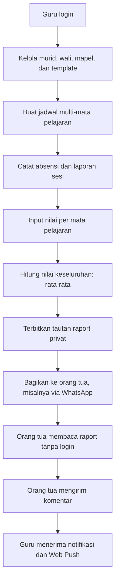
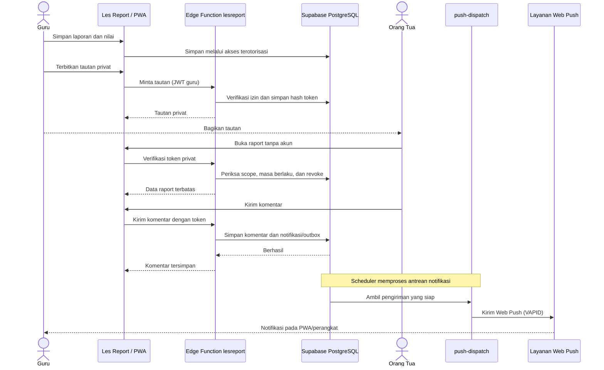
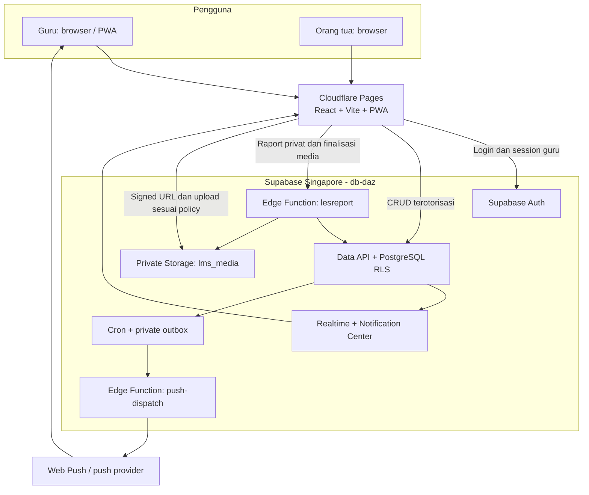

# Les Report (LMS-DAZ)

**Les Report** adalah aplikasi pengelolaan les privat untuk guru, mulai dari data murid, jadwal, absensi, laporan pembelajaran, penilaian, hingga pembayaran. Orang tua dapat membuka **raport digital melalui tautan privat tanpa login**, mengirim komentar, dan guru akan menerima notifikasi di aplikasi/PWA.

**Aplikasi:** [lms.daztore.web.id](https://lms.daztore.web.id)  
**Frontend:** React + Vite PWA di Cloudflare Pages  
**Backend:** Supabase Singapore (`db-daz`)

## Tujuan

- Memusatkan administrasi les dan riwayat perkembangan murid dalam satu aplikasi.
- Memudahkan guru mendokumentasikan pembelajaran dan nilai secara konsisten.
- Memudahkan orang tua memantau hasil les dan memberikan umpan balik tanpa membuat akun.
- Mendukung akses desktop dan mobile, termasuk instalasi PWA serta notifikasi komentar.

## Cara kerja

Alur utama dimulai dari guru yang mengelola kegiatan les hingga orang tua membaca raport dan mengirim komentar.



> **Contoh penilaian:** Matematika 90 dan IPA 80 dalam satu laporan menghasilkan nilai keseluruhan **85**. Guru dapat memilih hanya mata pelajaran yang benar-benar diajarkan pada sesi tersebut.

## Fitur utama

| Modul | Fungsi |
| --- | --- |
| **Murid & Orang Tua** | Profil, relasi wali, dan riwayat kegiatan les. |
| **Jadwal** | Satu jadwal dapat mencakup beberapa mata pelajaran. |
| **Absensi** | Catat kehadiran per sesi dengan perlindungan terhadap pencatatan ganda. |
| **Laporan & Nilai** | Raport per sesi, nilai tiap mata pelajaran, dan nilai keseluruhan otomatis. |
| **Raport Digital Privat** | Tautan berbatas waktu/cakupan, dapat dicabut, tanpa akun orang tua. |
| **Komentar & Notifikasi** | Komentar orang tua, pusat notifikasi guru, Realtime, dan Web Push PWA. |
| **Pembayaran** | Tagihan dan transaksi dengan status/saldo berdasarkan ledger pembayaran. |
| **Foto & Media** | Private Storage, WebP, varian thumbnail, dan signed URL sementara. |
| **PWA & Draft** | Instalasi ke perangkat serta pemulihan input form yang belum disimpan. |

## Alur raport privat & notifikasi

Akses orang tua diproses oleh backend tepercaya; komentar disimpan terlebih dahulu sebelum notifikasi dikirim. Pengiriman Web Push berjalan terpisah agar kegagalan push tidak membatalkan komentar.



**Catatan:** Web Push memerlukan izin notifikasi. Pada iPhone, PWA harus ditambahkan ke Home Screen (iOS 16.4+). Bunyi notifikasi ketika aplikasi di background mengikuti pengaturan sistem operasi.

## Arsitektur & infrastruktur



| Lapisan | Teknologi | Tanggung jawab |
| --- | --- | --- |
| **Frontend** | React, TypeScript, Vite, Tailwind CSS | UI responsif guru dan portal raport orang tua. |
| **Hosting** | Cloudflare Pages | Menyajikan SPA dan aset statis melalui CDN. |
| **PWA** | Web App Manifest & Service Worker | Instalasi aplikasi, caching aset, penerimaan push. |
| **Data fetching** | TanStack Query | Cache memori per akun, deduplikasi, dan invalidasi data. |
| **Database** | Supabase PostgreSQL (Singapore) | Data operasional, relasi, RLS, constraint, RPC. |
| **Authentication** | Supabase Auth | Login dan sesi guru. |
| **Media** | Private Supabase Storage `lms_media` | Foto, avatar, dan varian WebP. |
| **Trusted backend** | Edge Functions `lesreport`, `push-dispatch` | Token raport, operasi media, distribusi Web Push. |
| **Notifikasi** | Realtime, private outbox, Cron, VAPID | Notifikasi langsung dan push ke perangkat guru. |

**Tidak ada server aplikasi Express/Fastify di Cloudflare Pages.** UI statis dilayani Cloudflare, sementara data bisnis dan operasi tepercaya ditangani Supabase.

## Keamanan, integritas & performa

- **Namespace:** tabel bisnis LMS memakai prefix `lms_`; bucket media privat bernama `lms_media`. Tabel bawaan Supabase seperti `auth.users` tidak diubah.
- **Isolasi akun:** akses guru dilindungi Supabase Auth, RLS, ownership, dan validasi backend. Orang tua hanya bisa mengakses data sesuai token privat yang masih berlaku.
- **Tautan privat:** token disimpan dalam bentuk hash, memiliki cakupan dan kedaluwarsa, serta dapat dicabut. Signed URL media berlaku **60 detik**; URL yang sudah diterbitkan mungkin tetap bisa diakses hingga masa berlakunya habis.
- **Keandalan data:** update dengan versi stale ditolak HTTP 409; transaksi pembayaran atomik dan idempoten; absensi memiliki proteksi duplikasi.
- **Cache:** Supabase tetap menjadi *source of truth*. TanStack Query menggunakan cache memori; `localStorage` hanya untuk draft form yang belum tersimpan. Data privat dan signed URL tidak disimpan ke cache persisten Service Worker.
- **Gambar:** kompresi/resize sebelum upload dan varian WebP untuk avatar, thumbnail, dan detail menghindari unduhan foto asli berukuran besar.
- **Notifikasi:** kegagalan pengiriman push tidak membatalkan komentar yang sudah tersimpan; outbox memfasilitasi pengiriman ulang terkontrol.

## Menjalankan secara lokal

**Prasyarat:** Node.js **22.12+**, npm, serta project Supabase development yang telah dikonfigurasi.

```bash
npm ci
cp .env.example .env.local
npm run dev
```

Isi `.env.local` dengan key publik untuk project development:

```env
VITE_SUPABASE_URL=https://<project-ref>.supabase.co
VITE_SUPABASE_PUBLISHABLE_KEY=sb_publishable_...
VITE_VAPID_PUBLIC_KEY=<vapid-public-key>
```

Aplikasi berjalan di **http://localhost:3000**. Akun guru dikelola melalui Supabase Auth. Jangan gunakan database production untuk seed atau eksperimen.

> **Penting:** jangan memasukkan password database, access token, service-role/secret key, VAPID private key, atau secret dispatcher ke variabel `VITE_*`, Git, maupun bundle frontend. Gunakan environment/secrets backend yang sesuai.

## Validasi & build

```bash
npm run typecheck
npm run typecheck:edge
npm run lint
npm test
npm run build
```

Hasil build tersedia di `dist/`. Test lokal tidak menggantikan smoke test terhadap Supabase hosted atau pengujian PWA pada perangkat nyata.

## Deployment production

| Pengaturan Cloudflare Pages | Nilai |
| --- | --- |
| Domain | [lms.daztore.web.id](https://lms.daztore.web.id) |
| Branch rilis | `main` |
| Build command | `npm run build` |
| Output directory | `dist` |
| Root directory | Root repository |
| Build variables | `VITE_SUPABASE_URL`, `VITE_SUPABASE_PUBLISHABLE_KEY`, `VITE_VAPID_PUBLIC_KEY` |

Backend production menggunakan project Supabase **`db-daz` di Singapore (`ap-southeast-1`)**.

- Simpan perubahan schema dalam migration versioned di `supabase/migrations/`.
- Deploy Edge Functions dan atur secrets, Vault, serta scheduler pada project yang benar.
- Pastikan Supabase Auth redirects dan Edge `ALLOWED_ORIGINS` sesuai domain yang diizinkan.
- Lakukan **redeploy Pages** setiap kali build variables `VITE_*` berubah.
- Project Supabase lama di US tetap digunakan aplikasi lain. **Jangan melakukan full restore US ke `db-daz`**, karena Singapore sudah menyimpan data production yang lebih baru.

## Dokumentasi teknis

Dokumentasi mendalam disimpan di folder [`docs/`](docs/), sedangkan README ini menjelaskan produk dan arsitektur utamanya.

- [Migrasi US → Singapore & cutover](docs/SUPABASE_FULL_MIGRATION.md)
- [Schema dan namespace `lms_`](docs/NAMESPACE_STATUS.md)
- [Jadwal multi-mata pelajaran](docs/MULTI_SUBJECT_SCHEDULES.md)
- [Draft form & PWA](docs/DRAFTS_PWA.md)
- [Optimasi cache & gambar](docs/CACHE_IMAGES.md)
- [Notifikasi & Web Push](docs/PUSH_NOTIFICATIONS.md)
- [Status migrasi awal](docs/MIGRATION_STATUS.md)
- [Riwayat perbaikan CORS production](docs/PRODUCTION_CORS_STATUS.md)
